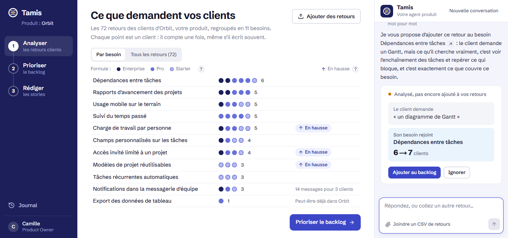
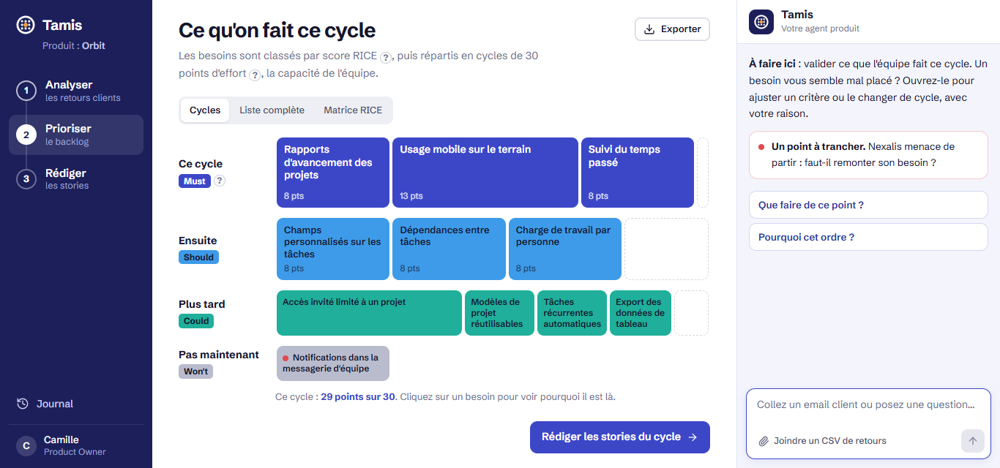
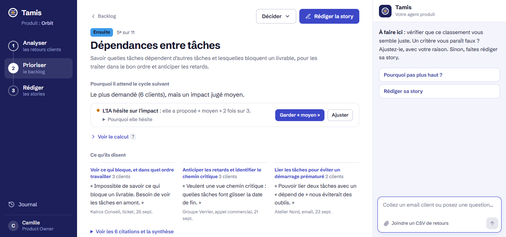
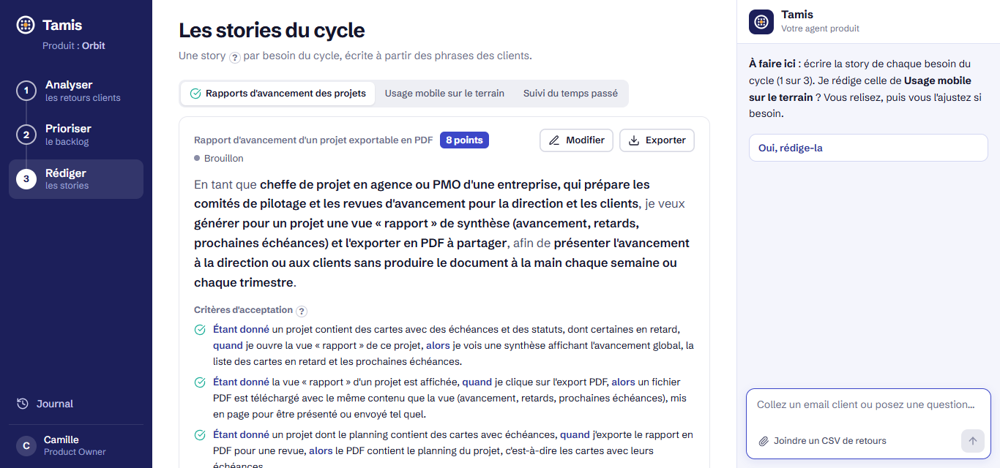
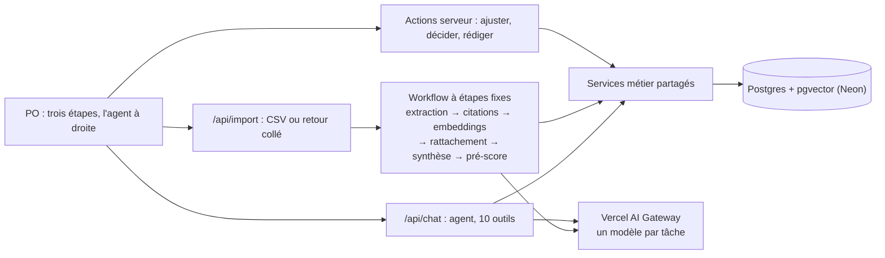

# Tamis

> **In English.** Tamis is an AI agent for Product Owners. It reads customer feedback (emails, tickets, in-app comments, sales-call notes), extracts the feature requests and the need behind each one, groups them into needs, spots the trends, ranks the needs with RICE and MoSCoW, and drafts user stories with acceptance criteria and a relative complexity estimate. The navigation is the three steps of the brief: analyse the feedback, prioritise the backlog, write the stories. Each step is one screen with one question and one visual; the details are one click away. The agent sits in a panel beside every screen, always visible: it says what matters on the screen in two sentences, suggests questions, and answers with visuals built from real data. Paste an email and the agent shows which need it joins, without saving anything until the PO clicks. MoSCoW is suggested from the team's capacity (30 points per cycle). Every figure links to its evidence, every change goes through the PO, and everything is measured by an evaluation suite on an annotated dataset. Built with Next.js 16, the Vercel AI SDK, Claude (Opus for the agent, Sonnet for processing) and Postgres with pgvector. The interface and the documentation are in French.

**L'agent du Product Owner.** Tamis lit les retours clients (emails, tickets, commentaires, notes d'appel), en tire les demandes et le besoin derrière chacune, les regroupe en besoins, repère les tendances, classe les besoins avec RICE et MoSCoW, et rédige les user stories. Chaque chiffre renvoie à ses preuves, et le PO garde la main : l'agent propose, le PO décide, et chaque décision est tracée.

Le nom vient du geste du PO : passer des dizaines de retours au tamis pour ne garder que l'essentiel. L'agent fait le premier passage ; le PO garde le dernier mot.

**Démo en ligne** : [tamis-po.vercel.app](https://tamis-po.vercel.app), protégée par un code d'accès transmis avec le rendu. Le scénario de démonstration est dans [docs/DEMO.md](docs/DEMO.md).



| Étape 2 : ce qu'on fait ce cycle, MoSCoW selon la capacité | Un besoin : pourquoi il est à sa place, et les preuves |
|---|---|
|  |  |

| Étape 3 : la story, ses critères et sa complexité |
|---|
|  |

## Trois principes

1. **Rien sans preuve.** Toute demande cite le retour mot pour mot (vérifié par le code), toute synthèse renvoie à ses sources, et l'agent n'a pas le droit de donner un chiffre qu'un outil ne lui a pas fourni.
2. **Le PO garde la main.** L'agent analyse un retour collé sans l'enregistrer ; il propose des facteurs et des statuts, que le PO applique ou rejette d'un clic ; tout est recalculé et inscrit au journal.
3. **Le modèle juge, le code calcule.** Les jugements (extraire, regrouper en zone grise, proposer un impact) viennent du modèle, validés par un schéma. Les comptes, les scores, les rangs, le MoSCoW et les tendances sont du code testé.

## Ce que couvre Tamis

| Demande de l'énoncé | Dans Tamis |
|---|---|
| Traiter les retours (emails, tickets, commentaires) | Un email collé dans l'agent est analysé sur place ; un CSV de quatre canaux s'importe depuis l'agent ou l'étape Analyser. Dédoublonnage (le même texte, ou un email collé puis reçu en entier), extraction structurée : solution demandée, besoin sous-jacent, citation exacte, type, urgence. |
| Repérer les tendances | Regroupement des demandes en besoins stables (embeddings du besoin, confirmation par un modèle en zone grise, consolidation en fin d'import) ; demandes récentes contre demandes d'avant ; signaux de risque de départ et de fonctionnalité déjà existante. |
| Extraire les demandes de fonctionnalités | Zéro, une ou plusieurs demandes par retour ; un bug formulé comme une demande est classé bug ; un remerciement ne produit pas de demande. |
| Proposer un scoring sur plusieurs critères | RICE : clients distincts (calculés), impact, confiance et effort proposés par le modèle avec une justification, médiane de trois propositions. |
| Appliquer des frameworks (RICE, MoSCoW) | Score RICE et rang calculés par le code ; MoSCoW suggéré selon la capacité de l'équipe (30 points par cycle) et modifiable ; vues Cycles, Liste complète et Matrice RICE. Pourquoi pas ICE, WSJF ni Kano : [docs/DECISIONS.md](docs/DECISIONS.md). |
| Expliquer et justifier les recommandations | Chaque besoin dit en une phrase pourquoi il est à sa place (« Le plus demandé, mais un impact jugé moyen »), calculée par le code ; l'agent recommande en une phrase, et la carte affichée sous sa réponse montre les preuves ; chaque facteur affiche son origine (code, IA, PO), sa justification, et le doute de l'IA quand ses propositions divergent ; journal des décisions. |
| Générer des user stories | Story rédigée à partir des preuves du besoin : persona précis, besoin, bénéfice ; éditable, versionnée, exportable en Markdown. |
| Proposer des critères d'acceptation | Trois à cinq critères Étant donné / Quand / Alors, observables et testables. |
| Estimer la complexité relative | Points relatifs aux stories de référence de l'équipe, avec les références citées : un point de départ pour le planning poker. |

## Démarrer

Prérequis : Node 20 ou plus, pnpm 10, la CLI Vercel (`npm i -g vercel`). Les commandes sont écrites pour PowerShell et fonctionnent aussi sous macOS et Linux.

```powershell
pnpm install
vercel link                      # relie le dossier au projet Vercel
vercel env pull .env.local       # récupère DATABASE_URL et le jeton d'accès aux modèles
pnpm db:migrate                  # crée le schéma dans la base Postgres
pnpm seed                        # charge et traite le jeu de démo (environ 3 minutes, 1,10 $)
pnpm dev                         # http://localhost:3000
```

Sans projet Vercel : copier `.env.example` en `.env.local`, renseigner `DATABASE_URL` (n'importe quel Postgres avec l'extension pgvector) et `AI_GATEWAY_API_KEY` (clé du Vercel AI Gateway).

Pour lire et vérifier le code sans base ni clé, `pnpm install` suffit : `pnpm test`, `pnpm typecheck` et `pnpm lint` passent sans `.env.local`. `pnpm build` et `pnpm dev`, eux, lisent la base.

## Commandes

| Commande | Ce qu'elle fait |
|---|---|
| `pnpm dev` | Lance l'application en local. |
| `pnpm test` | Tests unitaires (Vitest) : lecture CSV, empreintes, ancrage des citations, rattachement, scoring, MoSCoW par capacité, phrase « pourquoi ce rang », consensus, tendances, points à trancher, code d'accès. Quelques secondes, sans réseau. |
| `pnpm eval` | Les huit évals sur le jeu annoté, avec de vrais appels aux modèles ; écrit un rapport daté dans `evals/reports/`. |
| `pnpm eval --bench` | Les évals, plus le banc d'essai : chaque tâche rejouée sur plusieurs modèles, pour comparer qualité et coût. |
| `pnpm seed` | Remet la démo dans son état de départ : 72 retours importés et traités (environ 3 minutes, 1,10 $). |
| `pnpm demo:save` | Sauvegarde la base telle quelle, toutes les tables et leurs vecteurs, dans `snapshots/demo.json` (ignoré par git). N'écrase jamais un instantané existant, sauf avec `--force`. |
| `pnpm demo:restore` | Remet la base dans l'état sauvegardé, à l'identique, en quelques secondes et sans appel aux modèles : la remise à zéro entre deux répétitions de la démo. La base est partagée avec la démo en ligne, qui change aussi. |
| `pnpm pipeline` | Reprend le traitement de ce qui n'a pas encore été traité. |
| `pnpm regroup` / `pnpm rescore` / `pnpm resynthesize` | Refait le regroupement, le pré-scoring ou la synthèse sans refaire l'extraction. |
| `pnpm data:build` | Régénère les CSV et les annotations à partir de `data/dataset.ts`. |
| `pnpm check:ai` | Vérifie que chaque modèle déclaré répond et que les embeddings ont la bonne dimension. |
| `pnpm db:migrate` | Applique les migrations SQL de `db/migrations`. |
| `pnpm typecheck` / `pnpm lint` / `pnpm build` | Contrôles avant livraison. |

## Architecture en bref



Une seule couche de services lit et écrit la base : l'interface, le traitement en masse et l'agent l'appellent tous. Le traitement est un workflow (des étapes fixes, mesurables) ; l'agent sert au dialogue : il analyse, explique, compare, propose et rédige, et chaque outil qu'il appelle s'affiche en visuel. Le détail est dans [docs/ARCHITECTURE.md](docs/ARCHITECTURE.md).

## Un modèle par tâche

Chaque tâche a son modèle, déclaré dans [lib/ai/models.ts](lib/ai/models.ts) et modifiable par une variable d'environnement. Le banc d'essai mesure chaque tâche sur plusieurs modèles ; la configuration retenue privilégie la qualité : Claude Sonnet 5.5 pour le traitement et les stories, Claude Opus 5.5 pour l'agent, GPT-5 pour juger les stories. Les mesures, et la configuration économe qui atteint aussi les cibles, sont dans [docs/EVALS.md](docs/EVALS.md).

## Documentation

| Document | Contenu |
|---|---|
| [docs/ARCHITECTURE.md](docs/ARCHITECTURE.md) | Composants, flux de données, outils de l'agent et leurs visuels, modèle de données, sécurité. |
| [docs/DECISIONS.md](docs/DECISIONS.md) | Les décisions techniques et produit, avec les alternatives écartées et leurs conséquences. |
| [docs/EVALS.md](docs/EVALS.md) | Ce qui est testé, ce qui est mesuré, les résultats et le banc d'essai des modèles. |
| [docs/DEMO.md](docs/DEMO.md) | Le scénario de démonstration, minuté, et la liste de vérification. |
| [docs/DEFIS.md](docs/DEFIS.md) | Les difficultés rencontrées et les solutions trouvées. |
| [DESIGN.md](DESIGN.md) | Le système de design de l'interface. |
| [data/README.md](data/README.md) | Le jeu de données de démonstration, ses pièges et ses annotations. |

## Limites connues

- Le jeu de données est synthétique et petit (82 retours) : les évals prouvent que le mécanisme fonctionne et se mesure, pas qu'il performerait sur des données réelles.
- Pas d'authentification ni de multi-utilisateur : un code d'accès protège la démo en ligne. La conversation avec l'agent vit dans l'onglet du navigateur.
- Pas d'intégrations réelles (support, ticketing) : import CSV ou retour collé, export Markdown et CSV.
- Le regroupement au fil de l'eau dépend de l'ordre d'arrivée ; une passe de consolidation en fin d'import, puis le regroupement manuel de deux besoins, corrigent les découpages en trop.
- Le traitement en masse tourne dans une requête : adapté à des lots de quelques dizaines de retours, pas à des milliers (voir les évolutions dans [docs/DECISIONS.md](docs/DECISIONS.md)).
